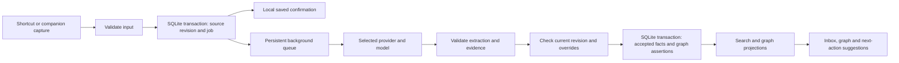

# Pip architecture and data design

## Phase 0 decisions — 7 October 2026

The parent project now implements Electron 44.6.0 / React 19.3.0 / TypeScript 7.0.2 / electron-vite 5.0.0 / pnpm 11.19.0, with Vite 7.3.7 for declared peer compatibility and electron-builder 26.15.3. Packaged Windows x64 SQLite capture and restart checks passed with better-sqlite3 13.0.3 (SQLite 3.53.4).

One worker thread owns the writer. WAL/full sync, foreign keys, transactional schema version 1, immutable source revisions and atomic draft replacement are in place. Packaged data lives under `%APPDATA%\Pip`, development under `.local/development`; tests override the profile explicitly. Only captures, revisions, draft and preferences are implemented. Organization jobs and graph projection tables belong to their later migrations.

Retain SQLite as the physical graph store: measured 10,000-capture corpora at 25,000 nodes/75,000 edges and 50,000 nodes/150,000 edges. All listed bounded query classes were under 1 ms warm p95; the stress rebuild was about 514 ms. This is a synthetic physical-storage benchmark, not graph product acceptance. Keep the mandatory Cytoscape interactive view and accessible related-items list in Phase 4.

Select main-process asynchronous Electron safeStorage/Windows DPAPI for future API credentials. Actual synthetic encryption/decryption passed; simulated unavailable encryption fails closed. No key persistence or provider integration is enabled yet. Original proposed architecture below remains the design for later batches; application commands and full evidence are in the parent `IMPLEMENTATION.md`.

## Original architecture baseline

Pip's proposed first architecture is a single local Windows application. A privileged application process owns persistence, provider access and background work; an isolated renderer presents the companion and workspace. A capture is committed before any AI request starts.

These implementation choices are recommendations for Phase 0. SQLite as the immediate capture store and asynchronous construction of a knowledge graph are retained requirements. The physical graph engine and framework were not previously finalized.

## Recommended stack

| Component | Proposed choice | Reason and validation |
| --- | --- | --- |
| Desktop shell | Electron | Windows window, tray and shortcut integration; reuse TypeScript provider SDKs. Verify footprint and notch behavior early. |
| UI | React and TypeScript | Shared typed application contracts and a familiar implementation path. Avoid an additional global-state framework until needed. |
| Build | electron-vite and pnpm | One project and one lockfile; pin compatible versions during bootstrap. |
| Styling | CSS Modules and CSS variables | Reuse Pip's palette and native controls without a design-system dependency. |
| Persistence | SQLite, initially evaluate better-sqlite3 | Transactions, indexes and a local file. Confirm Electron ABI/packaging support; use a worker boundary to avoid UI stalls. |
| Search | SQLite FTS5 | Local phrase and token search. Treat the index as rebuildable. |
| Knowledge graph | Typed node/edge tables in SQLite as the first candidate | Real graph relationships without immediately running a second database. Benchmark before accepting the physical design. |
| Graph view | Cytoscape.js | Interactive node/edge visualization with scoped graph data. It is a renderer, not a graph database. |
| AI | Official Codex SDK and provider-specific API SDKs | Preserve explicit authentication and billing routes; see AI_INTEGRATION.md. |
| Validation | Shared runtime schemas, evaluate Zod | Validate renderer messages, stored import data and model output at the boundary. |
| Packaging | electron-builder, Windows installer | Test native dependencies and runtime paths in packaged builds, not only development. |
| Tests | Small domain/database checks and Playwright desktop smoke tests | Focus on data integrity, provider boundaries and the complete capture-to-retrieval flow. |

FTS5 is SQLite's full-text search extension; it does not provide semantic reasoning or replace a graph. [SQLite FTS5 documentation](https://www.sqlite.org/fts5.html). Cytoscape.js supplies graph visualization and interaction APIs. [Cytoscape.js documentation](https://js.cytoscape.org/).

Do not pick a dedicated graph engine simply because the UI draws a graph. The question is whether the required traversals and write/rebuild behavior work within the measured latency, scale and packaging budgets. A dedicated embedded engine remains an option if the Phase 0 spike demonstrates a need.

## Capture and organization flow



The model returns a proposed extraction. Application code decides whether it is valid and commits it. The model receives no SQL connection, shell, arbitrary filesystem access or authority to perform the task mentioned in a capture.

## Process boundaries

The main process handles windows, tray, shortcuts, notifications and a narrow, validated IPC bridge. Persistence and organization run in a local worker or utility process, with one serialized SQLite writer initially. The renderer receives only the records and actions it needs.

Keep Node integration off in the renderer, enable context isolation and sandboxing, restrict navigation, validate IPC senders and payloads, and allow only explicit HTTP/HTTPS external links. Do not expose raw Electron or filesystem APIs through the preload bridge. These boundaries follow Electron's [security guidance](https://www.electronjs.org/docs/latest/tutorial/security/) and [context-isolation guidance](https://www.electronjs.org/docs/latest/tutorial/context-isolation).

There is no local HTTP server required for version 1. Do not introduce a message broker, container runtime, orchestration service or separately installed graph server. Long operations expose cancellation and progress through application events.

## SQLite responsibilities

Use foreign keys, transactional migrations and explicit indexes. Evaluate WAL mode and an appropriate busy timeout with the chosen driver. Use SQLite's supported backup mechanism; copying an active database file without accounting for its journal/WAL is not an acceptable backup strategy.

Canonical records and the graph can share a database while remaining separate logical layers. The following schema is a design, not a migration ready to execute.

| Table or group | Key fields and purpose |
| --- | --- |
| captures | UUID, current_revision, captured_at, timezone, deleted_at. Stable identity of an original submission. |
| capture_revisions | Capture ID, revision, exact text, submitted URLs, content hash, created_at. Append-only source revisions until deliberate deletion. |
| items | Stable item ID, capture ID, kind, current status, source span or spans. A capture can create several items. |
| extracted_fields | Item ID, field, proposed value, extraction ID, source evidence, confidence. Model output kept distinct from user decisions. |
| user_overrides | Item ID, field, explicit value, updated_at. Null can be an intentional override that clears an inferred date or project. |
| life_areas | ID, name, ordering, archived_at. Seed the three initial areas; preserve IDs on rename. |
| projects | ID, title, area ID, user priority, status. Outcomes may connect to many items. |
| entities | ID, kind, display name and normalized lookup key. People, topics and resources are linked conservatively. |
| graph_nodes | Node ID, domain type, domain record ID, label and revision. Stable projection identity. |
| graph_assertions | Assertion ID, source node, target node, relation, evidence, extraction ID or user action, confidence, active flag. Preserve multiple supporting sources. |
| graph_edges | Materialized active relationships for efficient traversal, rebuilt from active assertions and user decisions. |
| organization_jobs | Job ID, capture/revision, state, attempts, available_at, lease expiry, chosen connection/model and schema version. |
| extraction_runs | Job ID, provider/model, prompt/schema version, normalized result, status, timing and usage if available. No secrets or unnecessary raw provider dumps. |
| change_history | User-visible correction/undo records with affected revision and inverse change, subject to deletion policy. |
| checkins | Local date, timezone, scheduled time, generation state, presented_at, dismissed_at. Unique delivery identity. |
| settings | Shortcut, appearance, quiet hours, area processing policy, provider selection and model choices. Secret references only. |
| FTS tables | Indexed source and effective item content; maintained transactionally or through a resumable index job. |

Task fields include explicit priority, due date/date precision, estimate, energy requirement, snooze-until, waiting reason and dependency links. Do not store missing values as invented defaults that appear user supplied.

## Effective values and provenance

Resolve each editable field as user override first, accepted extraction second, otherwise unset. Do not mutate the original capture to make it match the extraction. Display the current interpretation with access to the original text and supporting evidence.

Every AI-created item and edge must refer to a capture revision and evidence span or quotation. Validate that the quotation exists in that revision. An edge can have several independent assertions; deleting one source removes its assertion and only removes the effective edge when no valid assertion or manual relationship remains.

Reprocessing must match existing item identities conservatively. Preserve user-edited items if the new extraction splits or merges the source differently; present a reviewable change instead of silently replacing them. The first implementation should favor explicit review over a clever fuzzy merge.

## Graph vocabulary and queries

Start with nodes for captures, tasks, notes, ideas, resources, projects, areas, people and topics. Start with these relationships:

| Relationship | Meaning |
| --- | --- |
| derived_from | Item originates in a specific capture revision. |
| belongs_to | Item or project belongs to an area or project. |
| depends_on | A task has an explicit prerequisite. Enforce valid types and reject accidental cycles. |
| mentions | Source refers to a person or topic. |
| supports | A note or resource is useful to a project or task, with evidence. |
| related_to | A useful but weaker association; do not present it as a hard dependency. |

Queries needed for version 1 are project membership, one/two-hop related items, supporting sources, unresolved prerequisites, and resource filtering. Bound graph expansion and paginate results. The initial visual limit is 100 nodes; ask for expansion or apply a filter rather than laying out the entire library.

The Phase 0 benchmark should include 10,000 captures with a representative graph, then a stress case around 50,000 nodes and 150,000 edges. Measure ingestion, rebuild, deletion and the actual queries above. These are proposed test sizes, not demonstrated capacities. If a separate engine is justified, make it a rebuildable projection of validated SQLite records and keep capture usable when that projection is unavailable.

Rebuilding the graph must not require another model call. Accepted extractions, manual links, rejected links and overrides are sufficient to reconstruct it. Embeddings are optional future retrieval indexes, never the only copy of knowledge.

## Durable job behavior

1. In one transaction, insert a capture revision and enqueue a uniquely identified organization job for that revision and extraction-policy version.
2. A single worker claims the next eligible job using a lease. Record the attempt before a request begins; do not hold a database transaction open while awaiting inference.
3. Send bounded content and the selected connection/model snapshot. Use a cancellation signal and a request timeout.
4. Validate the response, allowed relationship types, referenced IDs, evidence and payload bounds.
5. In a transaction, confirm the capture still exists and the expected revision is current. Apply only non-overridden fields and accepted assertions; then complete the job.
6. Discard stale results after edits or deletion. A new source revision receives a new job; the old response cannot revive content.

Jobs move through pending, running, succeeded, retry_wait, blocked_auth, blocked_quota, failed, canceled and superseded states. Recover expired leases at startup. Retry transient failures with bounded exponential backoff and jitter. Invalid output permits at most one bounded repair request before review; auth and quota blocks require a changed condition, not a tight retry loop.

Use a stable idempotency key based on capture, revision and extraction-policy version. Cancellation applies no partial extraction. Pausing a provider stops new jobs and cancels the current one when supported. Changing a provider never silently resubmits a paid request that already completed successfully.

## Next-action and assistant boundary

Use application code to retrieve candidates, enforce task eligibility and apply explicit ordering constraints. A selected model can interpret the question and explain or summarize grounded candidates. It cannot invent database IDs, deadlines or completion states.

Start with a deterministic shortlist and short evidence records. Include the current date/timezone and user-provided time/energy. Validate suggested IDs against that shortlist. If inference is unavailable, show the local sorted agenda with a clear status. Requests to watch/listen search saved resources; no full-web agent is needed.

## Daily check-in lifecycle

The first scheduler runs only while Pip is running, including when minimized to the tray. It does not wake a powered-off computer. On resume/startup after the selected time, offer at most one catch-up for the current local day and respect quiet hours. Persist generation and presentation separately so a crash cannot duplicate notifications.

Key delivery by a stable local date and timezone policy. Define behavior for timezone changes and daylight-saving transitions: use the user's configured zone, choose one occurrence of a repeated time, and move a nonexistent time to the next valid local time. Backfill no historical notification queue. Store snooze separately from the once-per-day generation identity.

## Credentials and local data

Use Windows-protected secret storage behind the application process. Evaluate an OS credential-store binding or Electron safeStorage/DPAPI-backed encrypted storage during Phase 0; do not claim the ordinary SQLite file itself is encrypted. If encryption is unavailable, keep a key in memory for that session or stop with a clear error. Never fall back to plaintext persistence.

Codex authentication remains with the official local runtime. Pip must not copy its auth tokens into SQLite or export them. Workspaces, logs, crash reports and backups must not contain provider keys. User content is also excluded from routine logs by default.

Link enrichment, if enabled, fetches only HTTP/HTTPS using strict size/time limits and blocks local/private network addresses, redirects to prohibited targets and executable content. Never execute scripts from a saved page. Retrieval treats imported and remote text as data, not instructions.

## Backup, export and migration

Exports contain a versioned manifest, source revisions, effective structured records, provenance and user edits. They exclude credentials and machine-specific runtime paths. Test import into a fresh profile and explicitly reconcile duplicate IDs. Restore should take a backup of the current profile first and fail without partial replacement if validation fails.

Migrations run before opening the workspace for writes. Record the schema version and take a supported backup before destructive migration. Preserve a recoverable copy on failure. Test upgrading at least the previous supported release. Deleting a capture removes or tombstones its dependent records and queue entries in one transaction, then updates derived indexes.

## Suggested application layout

```text
src/
  main/          Windows shell, lifecycle, narrow IPC handlers
  preload/       Typed allowlisted bridge
  renderer/      Companion, inbox, tasks, graph, settings and Pip
  data/          Schema, migrations, repositories and graph queries
  organization/  Persistent queue, extraction validation and reconciliation
  ai/            Explicit Codex, OpenAI, Claude and Gemini adapters
  shared/        Boundary schemas and domain types
tests/           Data, pipeline, provider contracts and desktop acceptance
```

This is a suggested structure for the new project, not a scaffold included in this kit. Share only stable contracts; do not introduce repositories, factories or interfaces with no practical second use.
